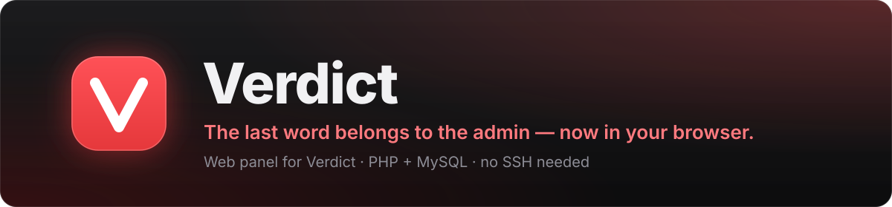

   

**English** · [Русский](README.ru.md)

[Features](#features) · [Requirements](#requirements) · [Installation](#installation) · [Game server](#game-server-access) · [Migration](#migration) · [Updating](#updating) · [Security](#security)

Web panel for the [**Verdict**](https://github.com/whyn0tq/cs2-verdict) plugin — bans, mutes and admins on Counter-Strike 2 servers. It installs on regular web hosting: only PHP and MySQL are needed, with no Node.js, no build step and no SSH. The plugin lives in [its own repository](https://github.com/whyn0tq/cs2-verdict) and runs on the game server. The panel and the plugin share one database and talk only through it.

- **No new database.** Runs on the Material Admin schema (`sb_bans`, `sb_comms`, `sb_admins`, `sb_srvgroups`, `sb_servers`). A Material Admin or SourceBans database plugs in as is.
- **Old passwords work.** Material Admin admins log in with their usual credentials and their web permissions carry over.
- **Own data stays separate.** Panel permissions, 2FA, logs and live online live in their own `vd_*` tables.

## Features

- Bans by SteamID and IP, mutes, gags and silence: issue, edit, remove, search
- Admins with flags, immunity, groups, expiry and per-server binding
- Group limits on ban and mute duration
- Many servers: status, map, players, RCON console
- Live scoreboard and chat, kick, move, slay and chat messages from the panel (needs the plugin)
- Steam avatars and profiles, player search by SteamID, profile link or short name
- Admin action log
- Two-factor login (TOTP: Google Authenticator, Aegis and others)
- Install wizard that creates the tables and prints ready-made plugin settings
- English and Russian, light and dark theme

## Requirements

| What | Needed |
|---|---|
| PHP | 5.2+, 7.4+ recommended (tested on 8.3) |
| PHP extensions | **PDO MySQL** (required), **OpenSSL** for 2FA keys, **cURL** or `allow_url_fopen` for Steam avatars and map images |
| Database | MySQL 5.5.3+ or MariaDB 10+ |
| Remote MySQL access | so the game server can reach the same database ([details](#game-server-access)) |
| Web server | Apache with `.htaccess` support |
| Game server | the [Verdict plugin](https://github.com/whyn0tq/cs2-verdict); without it the panel opens, but bans and mutes do not reach the server |

## Installation

1. **Download.** On this page choose *Code* → *Download ZIP* (or take an archive from *Releases*) and unpack it.
2. **Upload.** Copy all files to your hosting by FTP or the file manager, into the site root or a subfolder such as `public_html/bans/`. Include the `.htaccess` files — turn on hidden files in your FTP client.
3. **Write access.** The `data` folder must be writable by PHP: 755, or 775 if the wizard complains.
4. **Database.** Create a MySQL database and user in your hosting panel and note the host, name, user and password. To reuse a Material Admin, SourceBans or existing Verdict database, use it as is.
5. **Open the site.** The install wizard starts and checks PHP, PDO MySQL and `data` permissions.
6. **Install code.** Take it from the last line of `data/install-code.php`. It stops strangers from installing the panel on a freshly uploaded site.
7. **Connect the database.** Host, port (usually 3306), name, user, password and table prefix — `sb`, the same as `database_prefix` in the plugin's `core.ini`.
8. **Create the owner account** — login, password and, optionally, a SteamID.
9. **Add your first server** — IP, port and, optionally, the RCON password. You can skip this.
10. **Configure the game server.** The wizard prints ready blocks for `addons/configs/databases.cfg` and `addons/configs/verdict/core.ini`. Copy them to the game server and restart it.

Panel settings are stored in `data/config.php`. Delete that file to run the wizard again.

## Game server access

The plugin connects to the same database as the panel. Hosted databases usually accept only local connections, so:

1. Open **Remote MySQL** in your hosting panel (cPanel: *Remote MySQL*) and add the game server IP.
2. In `databases.cfg` on the game server, set `host` to the external MySQL address of your hosting, not `localhost`.
3. Give the database user full rights: the plugin creates missing tables itself.

Some cheap and free plans block remote MySQL. Use a plan that allows it, or a database from your game server host.

## Migration

Nothing to move: pick the same database and prefix in the wizard. Bans, mutes, admins, groups and servers appear as they are, and Material Admin web permissions are converted once during install. Upload the new panel into a separate folder instead of mixing it with an old one.

Data from cs2-admin_system is imported by the plugin: run `vd_import as_` in the game server console.

## Link with the plugin

Everything goes through the database, so no ports need opening on the game server.

- Set `server_id` (the server number in the panel) in `core.ini`. Every 5 seconds the plugin writes online and score to `vd_live_servers` / `vd_live_players`, and chat and events to `vd_feed`.
- Kick, move, slay and chat messages from the panel go to `vd_queue`; the plugin runs them within a second.
- Bans, mutes and admins issued in the panel apply on their own, with no restart.
- Without the plugin the panel shows status and players over A2S, and the RCON console works if a password is set. Your hosting must allow outgoing connections to the game server port.

Keep both parts up to date: new panel features, such as the live scoreboard, need a recent plugin.

## Updating

1. Back up the `data` folder.
2. Upload the new files over the old ones. Do not delete `data`.
3. Open the panel — new tables and fields are created on first load.

## Troubleshooting

| Problem | Fix |
|---|---|
| "PDO MySQL extension missing" | Enable `pdo_mysql` in your hosting PHP settings |
| "No write access to data" | Set `data` to 755 or 775 |
| Error 500 or blank page | Check the PHP version and the hosting error log |
| Wizard cannot reach the database | Copy host, name and user from your hosting; names often carry an account prefix (`user_verdict`) |
| Plugin cannot connect to the database | Remote MySQL is off, or `databases.cfg` still says `localhost` |
| Server shows as offline but the plugin works | Hosting blocks outgoing UDP; set `server_id` so status comes through the database |
| No live scoreboard or chat | `server_id` is missing in `core.ini`, or the plugin is old |
| No Steam avatars | Enable cURL or `allow_url_fopen` |
| Files in `includes`, `pages` or `data` open in a browser | Hosting ignores `.htaccess` — contact support |

## Security

- Turn on HTTPS — most hosts give a free Let's Encrypt certificate.
- Enable two-factor login in **Account**.
- Hand out flags `z` (root) and `m` (rcon) only when needed; only the owner can grant them.
- Never publish `data/config.php` or the install code.

---

Author: **teesa** ([whyn0tq](https://github.com/whyn0tq))

