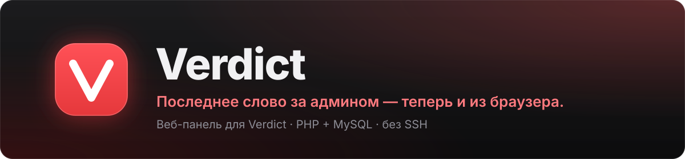

   

[English](README.md) · **Русский**

[Возможности](#возможности) · [Требования](#требования) · [Установка](#установка) · [Игровой сервер](#доступ-игрового-сервера-к-базе) · [Переход](#переход-с-других-панелей) · [Обновление](#обновление) · [Безопасность](#безопасность)

Веб-панель для плагина [**Verdict**](https://github.com/whyn0tq/cs2-verdict) — банов, мутов и админов на серверах Counter-Strike 2. Ставится на обычный веб-хостинг: нужны только PHP и MySQL, без Node.js, сборки и SSH. Плагин лежит в [отдельном репозитории](https://github.com/whyn0tq/cs2-verdict) и ставится на игровой сервер. Панель и плагин работают с одной базой и общаются только через неё.

- **Своя база не нужна.** Работает на схеме Material Admin (`sb_bans`, `sb_comms`, `sb_admins`, `sb_srvgroups`, `sb_servers`). Базу Material Admin или SourceBans можно подключить как есть.
- **Старые пароли подходят.** Админы Material Admin входят со своими логинами и паролями, веб-права переносятся.
- **Свои данные — отдельно.** Права панели, 2FA, журнал и живой онлайн лежат в таблицах `vd_*`.

## Возможности

- Баны по SteamID и IP, муты, гаги и сайленс: выдача, правка, снятие, поиск
- Админы с флагами, иммунитетом, группами, сроком действия и привязкой к серверам
- Ограничения группы на срок бана и мута
- Несколько серверов: статус, карта, игроки, RCON-консоль
- Живое табло и чат, кик, перевод в команду, убийство и сообщения в чат из панели (нужен плагин)
- Аватары и профили Steam, поиск игрока по SteamID, ссылке на профиль или короткому имени
- Журнал действий админов
- Двухфакторный вход (TOTP: Google Authenticator, Aegis и другие)
- Мастер установки: создаёт таблицы и выдаёт готовые настройки для плагина
- Русский и английский язык, светлая и тёмная тема

## Требования

| Что | Нужно |
|---|---|
| PHP | 5.2+, рекомендуется 7.4+ (проверено на 8.3) |
| Расширения PHP | **PDO MySQL** — обязательно, **OpenSSL** для ключей 2FA, **cURL** или `allow_url_fopen` для аватаров Steam и картинок карт |
| База данных | MySQL 5.5.3+ или MariaDB 10+ |
| Удалённый доступ к MySQL | чтобы игровой сервер подключался к той же базе ([подробнее](#доступ-игрового-сервера-к-базе)) |
| Веб-сервер | Apache с поддержкой `.htaccess` |
| Игровой сервер | плагин [Verdict](https://github.com/whyn0tq/cs2-verdict); без него панель откроется, но баны и муты не дойдут до сервера |

## Установка

1. **Скачайте.** На этой странице нажмите *Code* → *Download ZIP* (или возьмите архив из *Releases*) и распакуйте.
2. **Загрузите.** Скопируйте все файлы на хостинг по FTP или через файловый менеджер — в корень сайта или в подпапку, например `public_html/bans/`. Файлы `.htaccess` тоже нужны: включите показ скрытых файлов в FTP-клиенте.
3. **Права на запись.** Папка `data` должна быть доступна PHP для записи: 755, а если мастер ругается — 775.
4. **База.** Создайте базу MySQL и пользователя в панели хостинга, запишите адрес, имя, логин и пароль. Базу Material Admin, SourceBans или уже работающую с плагином используйте как есть.
5. **Откройте сайт.** Запустится мастер установки и проверит PHP, PDO MySQL и права на `data`.
6. **Код установки.** Он лежит в последней строке файла `data/install-code.php`. Это защита от того, чтобы панель на свежезагруженном сайте не установил посторонний.
7. **Подключите базу.** Адрес, порт (обычно 3306), имя, логин, пароль и префикс таблиц — `sb`, как `database_prefix` в `core.ini` плагина.
8. **Создайте владельца** — логин, пароль и, по желанию, SteamID.
9. **Добавьте первый сервер** — IP, порт и, по желанию, RCON-пароль. Шаг можно пропустить.
10. **Настройте игровой сервер.** В конце мастер покажет готовые блоки для `addons/configs/databases.cfg` и `addons/configs/verdict/core.ini`. Скопируйте их на игровой сервер и перезапустите его.

Настройки панели хранятся в `data/config.php`. Чтобы запустить мастер заново, удалите этот файл.

## Доступ игрового сервера к базе

Плагин подключается к той же базе, что и панель. Базы на хостинге обычно принимают только локальные подключения, поэтому:

1. Откройте «Удалённый доступ к MySQL» в панели хостинга (cPanel — *Remote MySQL*) и добавьте IP игрового сервера.
2. В `databases.cfg` на игровом сервере впишите в `host` внешний адрес MySQL хостинга, а не `localhost`.
3. Дайте пользователю базы полные права: плагин сам создаёт недостающие таблицы.

На части дешёвых и бесплатных тарифов удалённый MySQL закрыт. Нужен тариф с таким доступом или база у хостера игрового сервера.

## Переход с других панелей

Переносить ничего не нужно: в мастере укажите ту же базу и префикс. Баны, муты, админы, группы и серверы подхватятся, а веб-права Material Admin один раз переведутся при установке. Новую панель лучше загрузить в отдельную папку, а не поверх старой.

Данные из cs2-admin_system переносит плагин: выполните `vd_import as_` в консоли игрового сервера.

## Связь с плагином

Всё идёт через базу, открывать порты на игровом сервере не нужно.

- Укажите `server_id` (номер сервера в панели) в `core.ini`. Раз в 5 секунд плагин пишет онлайн и счёт в `vd_live_servers` / `vd_live_players`, а чат и события — в `vd_feed`.
- Кик, перевод в команду, убийство и сообщения из панели попадают в `vd_queue`, плагин выполняет их за секунду.
- Баны, муты и админы из панели применяются сами, без перезапуска.
- Без плагина панель показывает статус и игроков через A2S, а RCON-консоль работает при указанном пароле. Хостинг должен разрешать исходящие подключения к порту игрового сервера.

Держите обе части свежими: новые возможности панели, например живое табло, требуют свежего плагина.

## Обновление

1. Сделайте копию папки `data`.
2. Загрузите новые файлы поверх старых. Папку `data` не удаляйте.
3. Откройте панель — новые таблицы и поля создадутся при первом заходе.

## Частые проблемы

| Проблема | Решение |
|---|---|
| «Нет расширения PDO MySQL» | Включите `pdo_mysql` в настройках PHP хостинга |
| «Нет прав на запись в data» | Поставьте на `data` права 755 или 775 |
| Ошибка 500 или белый экран | Проверьте версию PHP и журнал ошибок хостинга |
| Мастер не подключается к базе | Возьмите адрес, имя и логин из раздела «Базы данных» хостинга; к имени часто добавляется префикс аккаунта (`user_verdict`) |
| Плагин не подключается к базе | Не включён удалённый MySQL или в `databases.cfg` стоит `localhost` |
| Сервер «не отвечает», но плагин работает | Хостинг закрывает исходящий UDP; укажите `server_id`, и статус пойдёт через базу |
| Нет живого табло и чата | В `core.ini` не указан `server_id` или стоит старый плагин |
| Нет аватаров Steam | Включите cURL или `allow_url_fopen` |
| Файлы из `includes`, `pages` или `data` открываются в браузере | Хостинг не читает `.htaccess` — напишите в поддержку |

## Безопасность

- Включите HTTPS — большинство хостингов дают бесплатный сертификат Let's Encrypt.
- Включите двухфакторный вход в разделе «Аккаунт».
- Не выдавайте флаги `z` (root) и `m` (rcon) без необходимости — их может выдавать только владелец.
- Не публикуйте `data/config.php` и код установки.

---

Автор: **teesa** ([whyn0tq](https://github.com/whyn0tq))

